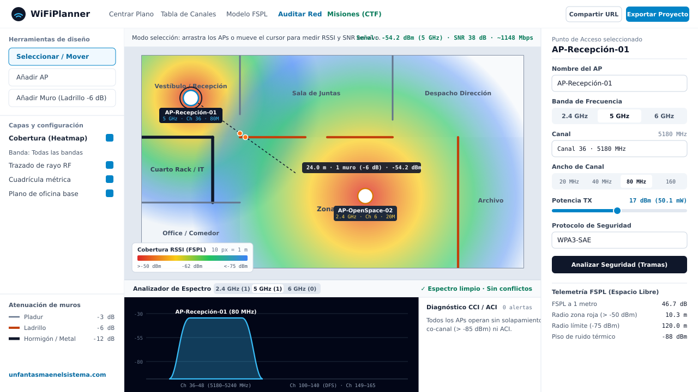
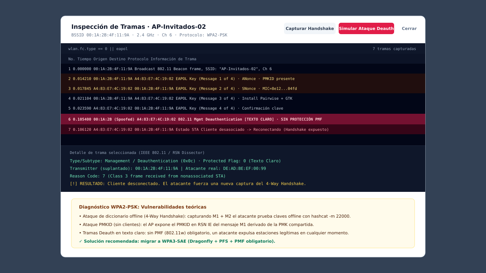
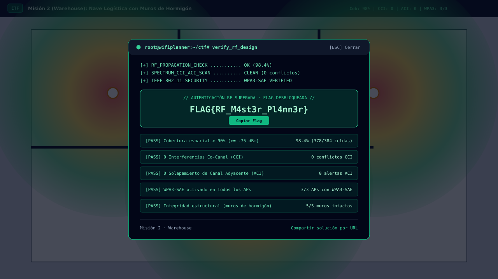

<div align="center">
  
  <h1>WiFiPlanner</h1>
  <p>
    <strong>Simulador educativo de planificación inalámbrica RF, análisis de espectro, seguridad 802.11 y retos CTF — 100% client-side.</strong>
  </p>
  <p>
    Proyecto educativo de <a href="https://www.unfantasmaenelsistema.com/" target="_blank" rel="noopener noreferrer">Un Fantasma en el Sistema</a>
  </p>
</div>

---

## Descripción general

**WiFiPlanner** es una aplicación web interactiva diseñada para docentes, estudiantes de redes y profesionales de ciberseguridad inalámbrica. Permite diseñar planos de cobertura Wi-Fi desde el navegador sin necesidad de servidor ni dependencias externas en producción, combinando física de propagación real (**FSPL + Raycasting 2D**), análisis espectral en bandas **2.4 / 5 / 6 GHz**, disección educativa de tramas **WPA2-PSK vs WPA3-SAE** y un motor de misiones tipo **Capture The Flag (CTF)** con compartición de escenarios mediante URL comprimida (`?state=...`).

---

## Capturas de pantalla

### 1. Planificación RF, Mapa de Calor FSPL, Trazado de Rayo y Analizador de Espectro


### 2. Inspector de Tramas 802.11 estilo Wireshark (WPA2-PSK vs WPA3-SAE + PMF)


### 3. Modo CTF, Misiones Prácticas y Validación de Flag


---

## Funcionalidades principales

### 1. Lienzo interactivo y gestión de infraestructura
- **Plano arquitectónico parametrizable** con cuadrícula métrica (`10 px = 1 metro`), zoom/paneo con ratón y carga opcional de imágenes de planos propios (`PNG`, `JPG`, `SVG`).
- **Drag & Drop** fluido de Puntos de Acceso (APs) con ajuste a cuadrícula (`0.5 m`).
- **Propiedades editables por AP**: Nombre, Banda (`2.4 GHz`, `5 GHz`, `6 GHz`), Canal (incluyendo marcas `DFS` y `PSC`), Ancho de Canal (`20`, `40`, `80`, `160 MHz`), Potencia TX (`5–30 dBm`) y Protocolo de Seguridad (`Abierto`, `WPA2-PSK`, `WPA3-SAE`, `WPA2/3-Enterprise`).
- **Exportación profesional**: guarda el proyecto en `.json`, importa configuraciones `.json`, exporta capturas del plano en `.png` y conserva tu progreso automáticamente en `localStorage`.

### 2. Motor de propagación FSPL y Raycasting contra muros
- **Pérdida en el Espacio Libre (FSPL)** calculada por celda y frecuencia central real:
  $$\text{FSPL (dB)} = 20 \cdot \log_{10}(d_{\text{m}}) + 20 \cdot \log_{10}(f_{\text{MHz}}) - 27.55$$
- **Muros con atenuación configurable**:
  - **Pladur**: `-3 dB`
  - **Ladrillo**: `-6 dB`
  - **Hormigón / Metal**: `-12 dB`
- **Filtro de banda en mapa de calor**: visualiza todas las bandas o aísla `2.4 GHz`, `5 GHz` o `6 GHz` para demostrar la mayor atenuación espacial en frecuencias altas.
- **Trazado de rayo RF en vivo**: muestra la línea directa desde el AP seleccionado hasta el cursor señalando cada intersección con muros, pérdida acumulada, `FSPL`, `RSSI`, `SNR` y tasa `PHY` estimada (`802.11ax`).

### 3. Analizador de espectro y detección CCI / ACI
- Panel inferior plegable con gráficas de campana **OFDM** independientes por banda (`2.4 GHz`, `5 GHz`, `6 GHz`) cuyo ancho espectral cambia dinámicamente según `20 / 40 / 80 / 160 MHz`.
- **Detección CCI (Co-Channel Interference)**: resalta en rojo APs en el mismo canal con señal mutua `> -85 dBm` y dibuja enlaces de conflicto sobre el plano.
- **Detección ACI (Adjacent-Channel Interference)**: alerta sobre canales solapados en `2.4 GHz` (ej. canales `1` y `3`, o `40 MHz` en `2.4 GHz`) y bloques vinculados superpuestos en `5 / 6 GHz`.

### 4. Módulo educativo de seguridad inalámbrica y auditoría
- **Analizar Seguridad (Tramas)**: visor estilo Wireshark + disector `IEEE 802.11 / RSN` por AP:
  - **WPA2-PSK**: simula el *4-Way Handshake* (`M1–M4`), expone el `PMKID` en `M1`, explica ataques de diccionario offline (`hashcat -m 22000`) y ejecuta tramas `Deauth` en texto claro sin PMF.
  - **WPA3-SAE**: simula el intercambio *Dragonfly* (`SAE Commit` + `SAE Confirm` en `ECP-256`), explica la resistencia frente a fuerza bruta offline, el Secreto Perfecto hacia Adelante (`PFS`) y bloquea ataques `Deauth` mediante `PMF (802.11w)` y `SA Query`.
- **Auditar Red**: recorre todos los APs, conflictos `CCI/ACI` y estancias del plano generando un informe completo de vulnerabilidades y cobertura media por habitación (exportable en `.txt`).

### 5. Modo CTF y compartición sin servidor (`?state=`)
- **Misiones predefinidas**:
  1. **Misión 1 (Densidad · Sala de Prensa)**: corrige 5 APs solapados en `2.4 GHz` (`40 MHz` y canales intermedios) y migra a `WPA3-SAE`.
  2. **Misión 2 (Warehouse · Nave Logística)**: logra `> 90%` de cobertura cruzando muros de hormigón (`-12 dB`) con máximo `3 APs` sin interferencias.
  3. **Misión 3 (Wi-Fi 6E & PMF · Auditorio Tech)**: resuelve colisiones de `80/160 MHz` en `5 GHz` migrando a canales limpios / `6 GHz PSC` con `WPA3-SAE`.
- **Evaluación automática de Flags**: verifica `Cobertura > 90% (>= -75 dBm)`, `0 CCI`, `0 ACI`, `WPA3-SAE` activo y restricciones de misión para desbloquear `FLAG{RF_M4st3r_Pl4nn3r}`.
- **Codificación de estado en URL (`?state=...`)**: serializa el escenario completo en JSON, lo comprime con `deflate-raw` + Base64 URL-safe y actualiza la URL para compartir ejercicios entre profesores y alumnos sin backend.

---

## Atajos de teclado

| Tecla | Acción |
| --- | --- |
| `V` | Herramienta Seleccionar / Mover AP |
| `A` | Herramienta Añadir AP |
| `W` | Herramienta Trazar Muro |
| `Espacio + Arrastrar` | Desplazar (Pan) el lienzo |
| `Rueda del ratón` | Zoom centrado en el cursor |
| `Supr` / `Retroceso` | Eliminar AP o muro seleccionado |
| `Esc` | Cancelar trazado o cerrar modal activo |

---

## Instalación y desarrollo local

```bash
# 1. Clonar el repositorio
git clone https://github.com/<tu-usuario>/wifiplanner.git
cd wifiplanner

# 2. Instalar dependencias
npm install

# 3. Iniciar servidor de desarrollo (puerto 3000)
npm run dev

# 4. Verificar tipos TypeScript y generar build estático para producción
npm run lint
npm run build
```

El resultado compilado listo para servir de forma estática se genera en la carpeta `dist/`.

---

## Despliegue en GitHub Pages

El proyecto está preconfigurado con `base: './'` en `vite.config.ts` e incluye el flujo automático `.github/workflows/deploy.yml`:

1. Sube el repositorio a GitHub en la rama `main`.
2. Ve a **Settings → Pages → Build and deployment** y selecciona **GitHub Actions** como origen.
3. Cada `push` a `main` compilará automáticamente la aplicación con Vite y publicará `dist/` en GitHub Pages.

---

## Estructura del proyecto

```text
├── .github/workflows/
│   └── deploy.yml                  # CI/CD automático hacia GitHub Pages
├── docs/screenshots/               # Capturas vectoriales de la aplicación
│   ├── 01-heatmap-espectro.svg
│   ├── 02-seguridad-tramas.svg
│   └── 03-modo-ctf-flag.svg
├── public/assets/aistudio/         # Logotipo e icono de la aplicación
├── src/
│   └── index.css                   # Estilos globales y Tailwind CSS v4
├── index.html                      # Aplicación completa modularizada (UI + Motor RF + CTF)
├── package.json
├── vite.config.ts                  # Configuración Vite con base relativa para GitHub Pages
└── LICENSE                         # Licencia MIT
```

---

## Licencia

Distribuido bajo licencia **MIT**. Consulta el archivo [LICENSE](LICENSE) para más detalles.
Creado para fines educativos en colaboración con [unfantasmaenelsistema.com](https://www.unfantasmaenelsistema.com/).
