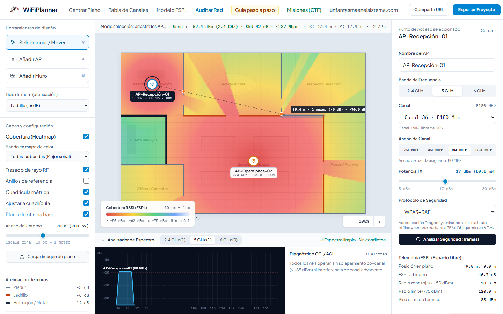
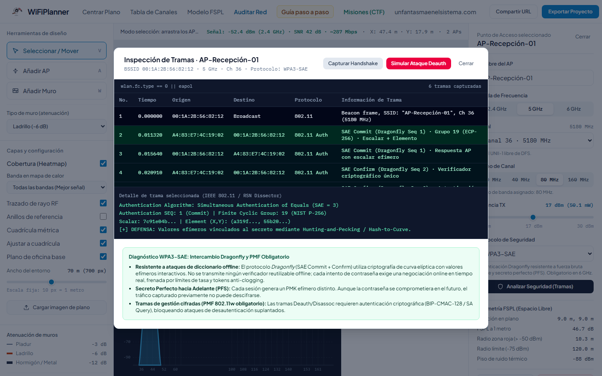
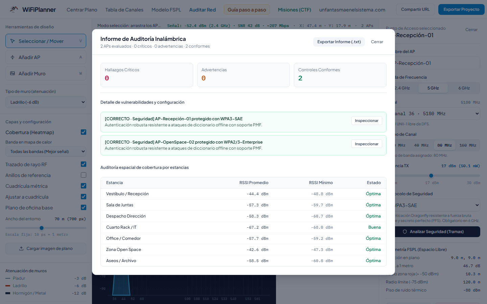
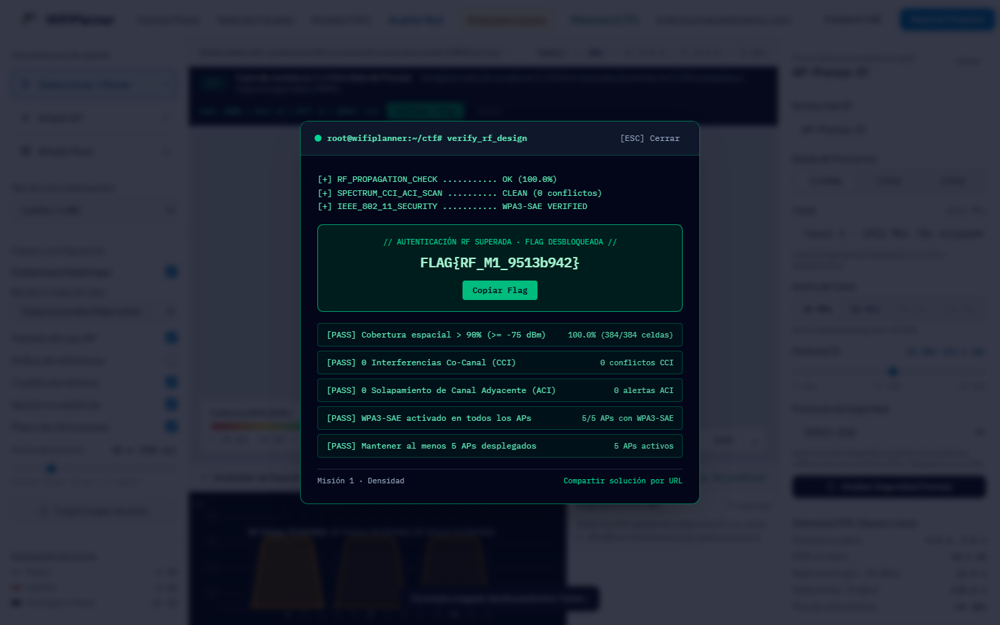
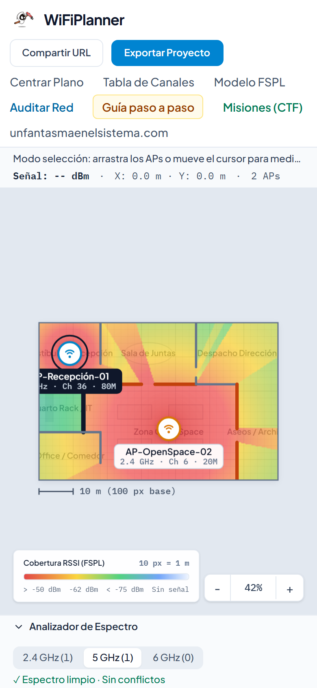

<div align="center">
  
  <h1>WiFiPlanner</h1>
  <p>
    <strong>Simulador educativo de planificación inalámbrica RF, análisis de espectro, seguridad 802.11 y retos CTF — 100% client-side.</strong>
  </p>
  <p>
    Proyecto educativo de <a href="https://www.unfantasmaenelsistema.com/" target="_blank" rel="noopener noreferrer">Un Fantasma en el Sistema</a>
  </p>
  <p>
    <a href="https://unfantasmaenelsistema.github.io/WiFiPlanner/"><strong>▶ Abrir WiFiPlanner en vivo</strong></a>
  </p>
  <p>
    <a href="https://unfantasmaenelsistema.github.io/WiFiPlanner/"></a>
    <a href="LICENSE"></a>
  </p>
</div>

---

## Descripción general

**WiFiPlanner** es una aplicación web interactiva diseñada para docentes, estudiantes de redes y profesionales de ciberseguridad inalámbrica. Permite diseñar planos de cobertura Wi-Fi desde el navegador sin necesidad de servidor ni dependencias externas en producción, combinando física de propagación real (**FSPL + Raycasting 2D**), análisis espectral en bandas **2.4 / 5 / 6 GHz**, disección educativa de tramas **WPA2-PSK vs WPA3-SAE** y un motor de misiones tipo **Capture The Flag (CTF)** con compartición de escenarios mediante URL comprimida (`?state=...`).

---

## Capturas de pantalla

Capturas reales de la aplicación.

### 1. Planificación RF, mapa de calor FSPL, trazado de rayo y analizador de espectro


### 2. Inspector de tramas 802.11 estilo Wireshark (WPA3-SAE + PMF)


### 3. Auditoría de red


### 4. Modo CTF y validación de la flag


### 5. Versión móvil


---

## Funcionalidades principales

### 1. Lienzo interactivo y gestión de infraestructura
- **Plano arquitectónico parametrizable** con cuadrícula métrica (`10 px = 1 metro`), zoom/paneo con ratón y carga opcional de imágenes de planos propios (`PNG`, `JPG`, `SVG`).
- **Drag & Drop** fluido de Puntos de Acceso (APs) con ajuste a cuadrícula (`0.5 m`).
- **Propiedades editables por AP**: Nombre, Banda (`2.4 GHz`, `5 GHz`, `6 GHz`), Canal (incluyendo marcas `DFS` y `PSC`, y aviso en los canales `149-165`, no disponibles para Wi-Fi en España ni en la UE), Ancho de Canal (`20`, `40`, `80`, `160 MHz`), Potencia TX (`5–30 dBm`) y Protocolo de Seguridad (`Abierto`, `WPA2-PSK`, `WPA3-SAE`, `WPA2/3-Enterprise`). Al cambiar de banda se aplica un canal recomendado y `20 MHz`.
- **Exportación profesional**: guarda el proyecto en `.json`, importa configuraciones `.json`, exporta capturas del plano en `.png` y conserva tu progreso automáticamente en `localStorage`.

### 2. Motor de propagación FSPL y Raycasting contra muros
- **Pérdida en el Espacio Libre (FSPL)** calculada por celda y frecuencia central real:
  $$\text{FSPL (dB)} = 20 \cdot \log_{10}(d_{\text{m}}) + 20 \cdot \log_{10}(f_{\text{MHz}}) - 27.55$$
- **Muros con atenuación configurable**:
  - **Pladur**: `-3 dB`
  - **Ladrillo**: `-6 dB`
  - **Hormigón / Metal**: `-12 dB`
- **Filtro de banda en mapa de calor**: visualiza todas las bandas o aísla `2.4 GHz`, `5 GHz` o `6 GHz` para demostrar la mayor atenuación espacial en frecuencias altas.
- **Trazado de rayo RF en vivo**: muestra la línea directa desde el AP seleccionado hasta el cursor señalando cada intersección con muros, pérdida acumulada, `FSPL`, `RSSI`, `SNR` y tasa `PHY` estimada (`802.11ax`).

### 3. Analizador de espectro y detección CCI / ACI
- Panel inferior plegable con gráficas de campana **OFDM** independientes por banda (`2.4 GHz`, `5 GHz`, `6 GHz`) cuyo ancho espectral cambia dinámicamente según `20 / 40 / 80 / 160 MHz`.
- **Detección CCI (Co-Channel Interference)**: resalta en rojo APs en el mismo canal con señal mutua `> -85 dBm` y dibuja enlaces de conflicto sobre el plano.
- **Detección ACI (Adjacent-Channel Interference)**: alerta sobre canales solapados en `2.4 GHz` (ej. canales `1` y `3`, o `40 MHz` en `2.4 GHz`) y bloques vinculados superpuestos en `5 / 6 GHz`.

### 4. Módulo educativo de seguridad inalámbrica y auditoría
- **Analizar Seguridad (Tramas)**: visor estilo Wireshark + disector `IEEE 802.11 / RSN` por AP:
  - **WPA2-PSK**: simula el *4-Way Handshake* (`M1–M4`), expone el `PMKID` en `M1`, explica ataques de diccionario offline (`hashcat -m 22000`) y ejecuta tramas `Deauth` en texto claro sin PMF.
  - **WPA3-SAE**: simula el intercambio *Dragonfly* (`SAE Commit` + `SAE Confirm` en `ECP-256`), explica la resistencia frente a fuerza bruta offline, el Secreto Perfecto hacia Adelante (`PFS`) y bloquea ataques `Deauth` mediante `PMF (802.11w)` y `SA Query`.
- **Auditar Red**: recorre todos los APs, conflictos `CCI/ACI` y estancias del plano generando un informe completo de vulnerabilidades y cobertura media por habitación (exportable en `.txt`). Incluye la **normativa europea (ETSI)**: avisa si un AP supera la PIRE orientativa (`20 dBm` en 2.4 GHz, `23 dBm` en 5 GHz canales 36-64 y en 6 GHz, `30 dBm` en 5 GHz canales 100-140) o usa canales `149-165`.

### 5. Modo CTF y compartición sin servidor (`?state=`)
- **Misiones predefinidas**:
  1. **Misión 1 (Densidad · Sala de Prensa)**: corrige 5 APs solapados en `2.4 GHz` (`40 MHz` y canales intermedios) y migra a `WPA3-SAE` sin pasar de la PIRE máxima de la UE (`20 dBm` en 2.4 GHz).
  2. **Misión 2 (Warehouse · Nave Logística)**: logra `> 90%` de cobertura cruzando muros de hormigón (`-12 dB`) con máximo `3 APs` sin interferencias.
  3. **Misión 3 (Wi-Fi 6E & PMF · Auditorio Tech)**: resuelve colisiones de `80/160 MHz` en `5 GHz` migrando a canales limpios / `6 GHz PSC` con `WPA3-SAE`.
- **Evaluación automática de Flags**: verifica `Cobertura > 90% (>= -75 dBm)`, `0 CCI`, `0 ACI`, `WPA3-SAE` activo, la **normativa europea (ETSI)** (PIRE máxima por banda y ningún canal `149-165`) y las restricciones de cada misión (en la Misión 2, que los 5 muros de hormigón originales sigan en su sitio). Cada misión tiene **su propia flag** (`FLAG{RF_M1_…}`, `FLAG{RF_M2_…}`, `FLAG{RF_M3_…}`), que se genera al validar y no aparece escrita en el código HTML.
- **Codificación de estado en URL (`?state=...`)**: serializa el escenario completo en JSON y lo comprime con `deflate-raw` + Base64 URL-safe para compartir ejercicios entre profesores y alumnos sin backend. Al abrir un enlace, el escenario pasa al autoguardado y `?state` desaparece de la barra, así que recargar no deshace los cambios.

---

## Atajos de teclado

| Tecla | Acción |
| --- | --- |
| `V` | Herramienta Seleccionar / Mover AP |
| `A` | Herramienta Añadir AP |
| `W` | Herramienta Trazar Muro |
| `Espacio + Arrastrar` | Desplazar (Pan) el lienzo |
| `Rueda del ratón` | Zoom centrado en el cursor |
| `Supr` / `Retroceso` | Eliminar AP o muro seleccionado |
| `Esc` | Cancelar trazado o cerrar modal activo |

---

## Instalación y desarrollo local

La aplicación es HTML + JavaScript en un único `index.html`; Vite solo compila los estilos de Tailwind CSS. El proyecto usa [Bun](https://bun.sh/) (hay `bun.lock`):

```bash
git clone https://github.com/unfantasmaenelsistema/WiFiPlanner.git
cd WiFiPlanner
bun install
bun run dev      # servidor de desarrollo en http://localhost:3000
bun run build    # compilación estática en dist/
```

---

## Despliegue en GitHub Pages

El workflow [`.github/workflows/deploy.yml`](.github/workflows/deploy.yml) instala con Bun (`--frozen-lockfile`), compila con `base: './'` y publica `dist/` en cada `push` a `main`. En un *fork* basta con activar **Settings → Pages → Build and deployment → GitHub Actions**.

---

## Estructura del proyecto

```text
├── .github/workflows/
│   └── deploy.yml                  # CI/CD automático hacia GitHub Pages
├── docs/screenshots/               # Capturas reales de la aplicación (PNG)
├── public/assets/aistudio/         # Logotipo e icono de la aplicación
├── src/
│   └── index.css                   # Estilos globales y Tailwind CSS v4
├── index.html                      # Aplicación completa modularizada (UI + Motor RF + CTF)
├── package.json / bun.lock
├── vite.config.ts                  # Configuración Vite con base relativa para GitHub Pages
└── LICENSE                         # Licencia MIT
```

---

## Novedades de la versión 2

- **Publicada en GitHub Pages** dentro de la organización: el despliegue fallaba siempre (el workflow usaba la caché de npm sin `package-lock.json`); ahora usa Bun.
- **Interferencias:** dos APs en el mismo canal con señal débil entre ellos ya no se etiquetan como ACI; al pasar un AP a 2.4 GHz se aplica 20 MHz (antes 40 MHz, que generaba ACI crítico).
- **Canales 5 GHz de la UE:** añadidos 120, 124 y 128 (DFS) y sus agrupaciones de 40 y 80 MHz; aviso en los canales UNII-3 (149-165).
- **Normativa ETSI** en la auditoría (PIRE máxima por banda y canales no permitidos).
- **CTF:** una flag distinta por misión que ya no está en claro en el HTML, y la Misión 2 comprueba que los muros de hormigón originales siguen en su sitio (antes bastaba con dibujar cinco nuevos en una esquina).
- **Compartir por URL:** generar el enlace ya no cambia la barra de direcciones; tras abrir un enlace, recargar conserva los cambios.
- **Diseño adaptable a móvil:** plano arriba, paneles debajo y navegación visible.
- Eliminados los restos de la plantilla de AI Studio (React, Gemini, Express) que la app no usaba.
- **Flags con normativa europea:** las misiones exigen además cumplir la PIRE máxima de la UE y no usar los canales `149-165` (antes la flag salía aunque la auditoría marcara hallazgos críticos de normativa). La tabla de canales, la guía paso a paso y la pista de la Misión 3 ya no recomiendan el canal 149.

---

## Licencia

Distribuido bajo licencia **MIT**. Consulta el archivo [LICENSE](LICENSE) para más detalles.
Creado para fines educativos en colaboración con [unfantasmaenelsistema.com](https://www.unfantasmaenelsistema.com/).
